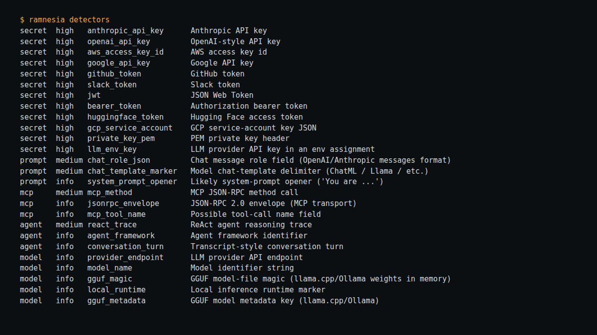

# RAMnesia

[](https://github.com/0xM44k/ramnesia/actions/workflows/ci.yml)


**Carve AI/agent artifacts out of memory.**

> **Authorized use only.** RAMnesia is a defensive memory-forensics tool — see
> [SECURITY.md](SECURITY.md). Analyse only memory you own or are permitted to examine.

RAMnesia scans a memory dump (or, via its Volatility 3 plugin, live process
memory in an image) for traces left by LLM agents and tools:

- **Secrets** — Anthropic / OpenAI / AWS / Google / GitHub / Slack keys, JWTs, bearer tokens
- **Prompts** — chat `role` fields, chat-template markers (ChatML, Llama `[INST]`, `<|user|>`), system-prompt openers
- **MCP / agent traffic** — JSON-RPC `tools/call`, `resources/read`, `initialize`, tool names
- **Model / endpoint** — provider API hosts and model identifiers

Existing memory-forensics tools recover browser, process and crypto artifacts, and recent work points LLMs *at* forensic output. To my knowledge there is no other tool that treats **the AI agent itself as the subject** and reconstructs what it was told, what it called, and what credentials it held, from RAM. That is the gap RAMnesia addresses.

> Forensics only. Use on memory you are authorised to analyse (your own hosts,
> your own lab, or an authorised engagement). Secrets are **redacted** in output
> by default so reports keep forensic value without re-leaking the key.

## Install

```bash
pip install -e .            # core CLI (stdlib only)
pip install -e .[volatility]  # + Volatility 3 plugin deps
```

## Use

```bash
# make a synthetic dump to try it out
python samples/make_sample.py sample_dump.bin

# scan it
ramnesia scan sample_dump.bin
ramnesia scan sample_dump.bin --only secret,mcp
ramnesia scan sample_dump.bin --json report.json

# list detectors
ramnesia detectors
```

Exit code is `1` when any **high**-severity (secret) artifact is found — handy in CI.

Reproduced on 2026-10-28 with the synthetic generator in this repository: three generated dumps each gave 37 findings (secret 10, prompt 6, mcp 3, agent 6, model 12), a 9-turn timeline, and GGUF metadata. Earlier release notes quoted 58 findings; that number did not reproduce and has been corrected. A clean 256 KB block of seeded random data gave no `model_name` findings after the short-pattern context fix.

## Scan a live process (Linux — the quickest real-memory test)

No image or Volatility needed: point RAMnesia at a running AI/agent process and
it carves its live address space via `/proc/<pid>/mem`.

```bash
# find your target (an Ollama server, a python LLM client, your MCP gateway)
pgrep -af ollama        # or: ps aux | grep python

# scan it (same user as the target, or sudo)
sudo ramnesia live <PID>
sudo ramnesia live <PID> --only secret,mcp --min-entropy 3.0
sudo ramnesia live <PID> --heap-stack --json live.json
```

If you get "permission denied", either run with `sudo` or check
`/proc/sys/kernel/yama/ptrace_scope` (0 allows same-user reads).

**Reduce false positives** with `--min-entropy 3.0` — it drops secret matches
whose Shannon entropy is too low to be a real key.

## Recover conversations & write an HTML report

```bash
# carve readable prompt/reply blocks out of a dump
ramnesia recover sample_dump.bin
ramnesia recover sample_dump.bin --html convos.html

# scan + recover + a shareable HTML report in one shot
ramnesia scan sample_dump.bin --recover --html report.html
```

The HTML report is **safe to share**: secret matches are redacted, raw context
bytes for secrets are never written into the file, and recovered conversation
text is blurred behind a toggle by default.

## Reconstruct a timeline & recover llama.cpp/Ollama context

```bash
# order recovered turns (system/user/assistant/tool, ReAct) by heap offset
ramnesia timeline sample_dump.bin
ramnesia timeline sample_dump.bin --html timeline.html

# pull GGUF metadata (model name, architecture, chat_template) + context text
ramnesia llama sample_dump.bin
```

Timelines order by heap offset (an allocation-order proxy — RAM has no
timestamps), and each turn carries a confidence. The `llama` command recovers
the **prompt/context text** and GGUF metadata resident in a local-inference
process; the raw KV-cache is numeric tensors, so the recoverable signal is the
context buffer and metadata, not the KV tensors themselves.

## Full memory image + Volatility 3

Capture a whole-system image on Linux, then scan every process:

```bash
# capture (pick one)
sudo avml mem.lime                 # Microsoft AVML, easiest
# or build/insert LiME: insmod lime.ko "path=/root/mem.lime format=lime"

# scan with the plugin
vol -f mem.lime -p ./ramnesia/volatility linux.ai_artifacts.AiArtifacts
```

## Volatility 3 plugin

Scan every process in a real memory image:

```bash
vol -p ./ramnesia/volatility windows.ai_artifacts.AiArtifacts
vol -p ./ramnesia/volatility windows.ai_artifacts.AiArtifacts --pid 4242
vol -p ./ramnesia/volatility windows.ai_artifacts.AiArtifacts --categories secret mcp
```

(Run on a Linux/DFIR host with `volatility3` installed and a real image.)

## Layout

```
ramnesia/
  patterns.py            detector definitions (add your own here)
  scanner.py             chunked, overlap-safe byte scanner
  report.py              JSON + coloured console
  cli.py                 `ramnesia` command
  volatility/ai_artifacts.py   Volatility 3 plugin
samples/make_sample.py   synthetic dump generator
tests/test_scanner.py    pytest suite
```

## Roadmap

Not done yet, in rough order of value:

- Evaluate on a genuine memory image (capture tool, format, process coverage and misses recorded); evidence so far is synthetic dumps only.
- Detector governance: version the detector set and add a positive and negative fixture per detector; record pattern changes in the CHANGELOG.
- Extend the short-pattern context rule applied to o-series model names in 0.4.x to other short patterns, with a stated false-positive count on a clean dump.
- The timeline reconstruction and HTML report listed here in earlier drafts are implemented; KV-cache tensor recovery is not claimed and is not on this list.

## License

MIT

Designed and built by Maak — https://github.com/0xM44k

## Evidence



The image above is a capture of the command shown at the top of the image, run against the files in this repository on 2026-10-28. It is the tool's actual output, rendered in a terminal panel for legibility; no output lines were invented.
